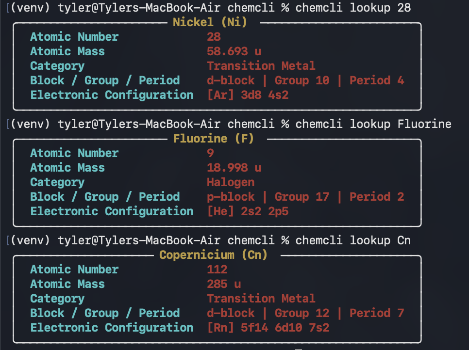
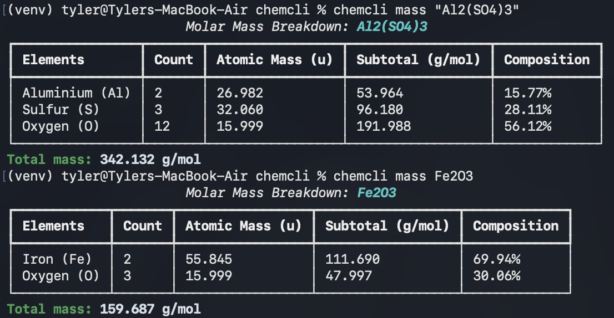

# chemcli
**Chemcli** is a terminal based *periodic table formula lookup* and *molar mass calculator* built in Python using rich.

## Features
- **Element Lookup:** You can search any of the 118 periodic elements by symbol, atomic number or full name (case insensitive). 
- **Molar Mass and Percentage Calculation:** You can calculate total molar mass, per-element mass and percentage composition for any valid chemical formula
- **Nested Parentheses Support:** You can calculate complex formulas that have group ions such as `Al2(SO4)3` and `Ca(OH)2`

## Tech stack
- Python3
- rich
- argparse
- json
- setuptools

## Preview



## How it was made?
I started by adding some elements in the json file and then created some functions to load elements, then to find the required element from the list of all the elements and then displaying it with the help of tables using rich.
After this, I started writing code for parsing the entered formula. I somehow managed to write code for parsing simple formulas like H2SO4, NaCl, etc.
What really got me was the logic for parsing complex formulas like Al2(SO4)3 and Ca(OH)2. I failed many times but finally got it.
I also hit silly bugs like typing '% composition' and it read this as %c and it behaved as a placeholder. 
After all of this, I worked with argparse and then the .toml file and then finally my project is ready to be shipped now.

## Here's how to install it and start finding masses and other info about your own formulas and elements.
1. Clone the source code to your device
```sh
git clone https://github.com/jalaj04/chemcli.git
```

2. Find the folder and make a virtual environment
```sh
cd chemcli
python -m venv venv
```

3. Activate the environment
On mac:
```sh
source venv/bin/activate
```
On windows:
```sh
venv\Scripts\activate
```

4. Install chemcli onto your device to use it in your terminal
```sh
pip install -e .
```


## Here's how to use it after following all the installation steps
1. To lookup elements
```sh
chemcli lookup [element]
```
2. To find mass of the given formula
```sh
chemcli mass [formula]
```